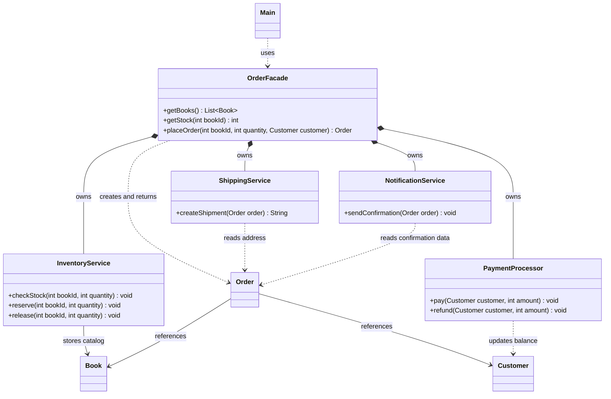

# Assignment 4 — Facade Pattern

**Author:** Yernur Darmenov, SE-2523.

Option B: a console book shop written in Java 17. A customer orders one book
in a chosen quantity. The catalog, stock and balance are stored in memory and
reset when the program restarts. Prices and balances are whole tenge (KZT).

## Run

Use JDK 17. Run these commands from the project root:

```sh
java -version
javac -version
mkdir -p out
javac --release 17 -encoding UTF-8 -d out src/*.java
java -cp out Main
```

The first two commands should show version 17. In IntelliJ IDEA, open the
project, select **Project SDK: 17**, and run `Main.main()`.

Run the checks without external libraries:

```sh
javac --release 17 -encoding UTF-8 -d out src/*.java
java -ea -cp out OrderFacadeTest
```

The `-ea` flag enables `assert` checks. The final message should be
`All facade checks passed`. The checks cover the four scenarios, ordering
again after rollback, buying the exact remaining stock and invalid inputs.

## Classes

The nine application classes are in `src/`.

| Class | Responsibility |
| --- | --- |
| `Book` | Stores the book ID, title and price. |
| `Customer` | Stores the customer's name, address and balance. |
| `Order` | Stores the order ID, book, customer, quantity, total, status and shipping number. |
| `InventoryService` | Holds the catalog and stock; checks, reserves and releases books. |
| `PaymentProcessor` | Checks the balance, charges the customer and refunds money. |
| `ShippingService` | Checks for a nonempty address and generates numbers such as `SHIP-1`. |
| `NotificationService` | Checks the order status, builds and prints a confirmation. |
| `OrderFacade` | Coordinates the services and rolls back payment or shipping failures. |
| `Main` | Runs four prepared examples. |

`src/OrderFacadeTest.java` is a separate class for checks, not part of the shop.

## How the facade works

The client calls `shop.placeOrder(bookId, quantity, customer)` and receives a
confirmed `Order` or a standard exception with a clear message. The facade
checks that a customer was supplied, then asks the services to check stock,
reserve books, take payment and create a shipment. It confirms the order and
asks the notification service to print the confirmation.

If stock is insufficient, processing stops before reservation and payment.
Reservation reduces available stock; a successful purchase keeps it reduced.
If payment fails, the facade releases the books. If the address is blank or
`null`, shipping fails after payment: the facade refunds the money, releases
the books, marks the order `CANCELLED` and rethrows the exception. The `paid`
flag becomes `true` only after a successful charge.

`Main` creates only the facade and data objects. It reads the catalog and
stock through `getBooks()` and `getStock()`, without accessing the services.
The services do not reference the facade and can also be used independently.

All `Main` scenarios use the same shop and a book priced at 3000 KZT:

| Scenario | Stock before → after | Balance before → after |
| --- | --- | --- |
| Success, 2 books | 5 → 3 | 10000 → 4000 |
| Request for 10 books | 3 → 3 | 10000 → 10000 |
| Insufficient balance | 3 → 3 | 1000 → 1000 |
| Empty address | 3 → 3 | 10000 → 10000 |

## UML class diagram



`*--` means composition (the facade creates and holds each service), `-->`
means association (a stored reference), and `..>` means dependency (uses).
No application class uses `extends` or `implements`: this design does not
need inheritance or interfaces. Selected members and the main relationships
are shown; getters and client dependencies on data objects are omitted.

## Five Clean Code principles

1. **Meaningful names.** This call in `Main` describes the action and its data:

   ```java
   Order order = shop.placeOrder(book.getId(), quantity, customer);
   ```

2. **Single responsibility.** `PaymentProcessor.pay()` checks the balance
   and takes payment. The facade calls it without repeating its logic:

   ```java
   if (customer.getBalance() < amount) {
       throw new IllegalStateException("Not enough money");
   }
   customer.setBalance(customer.getBalance() - amount);
   ```

3. **Hidden subsystem details.** This field in `OrderFacade` is private.
   The client uses a small API instead of controlling the payment service:

   ```java
   private final PaymentProcessor payment = new PaymentProcessor();
   ```

4. **Small methods and early validation.** The complete
   `ShippingService.createShipment()` checks the address and issues a number:

   ```java
   public String createShipment(Order order) {
       String address = order.getCustomer().getAddress();
       if (address == null || address.isBlank()) {
           throw new IllegalArgumentException("Delivery address is required");
       }
       return "SHIP-" + nextShippingNumber++;
   }
   ```

5. **Explicit error handling.** In the facade's `catch` block, money is
   refunded only after successful payment. The reservation exists because
   `reserve()` completed before entering `try`:

   ```java
   if (paid) {
       payment.refund(customer, order.getTotal());
   }
   inventory.release(bookId, quantity);
   order.cancel();
   throw e;
   ```
